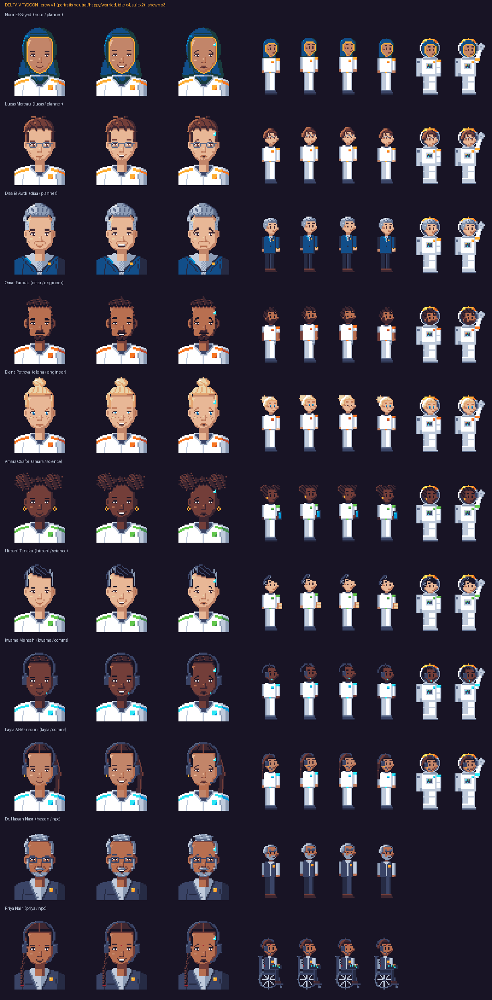

# Delta-V Tycoon

Design, launch and fly a space mission, alone or with up to 3 friends online.

**Play:** https://megumiinuwu.github.io/Delta-V-Tycoon/ · **Video:** _TBD_ · **Challenge:** NASA Space Apps 2026: Space Mission Design Game (NASA Space Apps Cairo 2026)

## What it is

Space missions are systems of trade-offs: a better instrument adds science, but also mass, power, data and cost, which ripple into the rocket, the battery and the radio. Students rarely get to feel these connections. Delta-V Tycoon is a free browser game where players, alone or as an online crew of up to four, design and fly a complete mission. They choose one of five missions inspired by real ones, from watching Nile Delta farms to mapping lunar ice and relaying Mars rover data. They split a budget between four roles, build the spacecraft part by part, and pick an orbit and a rocket while seven live meters show mass, power, budget, data, comms, time and delta-v. A readiness review, built on NASA JPL's Concept Maturity Levels, explains every NO-GO in plain language and tells the team when its concept reaches a flyable point design. Then they launch, handle random events such as solar storms and debris, and receive a report explaining why the mission succeeded or failed and what to try next. After launch, the game reveals the real mission their design resembles. Real formulas (rocket equation, power and link budgets) make every decision matter, and there is never one perfect design.

## How to play (2 minutes)

1. Pick a scenario and difficulty.
2. Split the budget.
3. Design: orbit, rocket, bus, power, instruments, comms.
4. Read the readiness review, fix NO-GO items, sign off.
5. Launch and handle surprises.
6. Read the report and try again.

## Team play

Create a room, share the 5-letter code, claim roles (Commander, Engineer, Science, Comms), agree on the budget, sign off together.

## The science inside

Rocket equation, power and eclipse budget, link budget and contact time, pointing accuracy, launch windows, space debris rules (see [docs/SOURCES.md](docs/SOURCES.md)).

The game is structured on NASA's own method:

- **Mission process** (Levri, NASA S3VI 2025): Need & Goals → Concept → Requirements & Design → Build & Verify → Implement → Results.
- **Mission segments**: Commander = launch segment, Engineer + Science Lead = space segment, Comms Officer = ground segment; each scenario names its user segment ("Who uses your data").
- **Concept Maturity Levels** (Wessen et al., JPL 2013): briefing = CML 1, live meters = CML 2, Trade-Space Explorer = CML 3, readiness review = CML 4 checklist with the 80% green rule.

Values are simplified game values inspired by these public sources.

## Built with

React, TypeScript, Vite, Zustand, Firebase Realtime Database, Recharts, lz-string; fonts Press Start 2P and VT323 (SIL OFL).

## Repository map

| Path | What | Owner |
| --- | --- | --- |
| `src/data/*.json` | All game content: orbits, rockets, parts, instruments, scenarios, events, checks, glossary, dialog, crew | Lead |
| `public/assets/characters/` | 53 crew PNGs: 33 portraits (64×64), 11 idle strips (128×48), 9 spacesuit strips (64×48) | Character art |
| `public/assets/voice/` | Character voice lines (mp3), one clip per speaker and line; `src/data/voice.json` lists them. Rebuild with `npm run voice` | Lead |
| `src/lab/` | Idea Lab (`#/lab`): prototypes that try ideas from community feedback, kept apart from the game screens and the core contract. Crew cabin hub, orbit poem, crew shorts. Screenshots in `docs/lab/` | Lead |
| `docs/GDD.md` | Short game design document | Lead |
| `docs/SOURCES.md` | Every source and what we used it for | Lead |

## Tools used

Disclosed as required by the NASA Space Apps code of ethics.

- **Claude (Anthropic), via Claude Code**: turned the team brief into the `src/data/*.json` content files and drafted README / GDD / SOURCES; wrote a Python + Pillow script that draws the crew sprites and portraits pixel by pixel on the 32-colour ENDESGA 32 palette (no image-generation model; every pixel is placed on the grid from the character sheets).
- **Claude (Anthropic), via Claude Code** also wrote `scripts/art/env_art.py`, which draws the environment art procedurally (backgrounds, planets, rockets, effects, spacecraft parts, event and scenario illustrations, logo). Every pixel comes from code shapes and the ENDESGA 32 palette; no image-generation model was used. It also wrote `scripts/art/sfx.py`, which synthesises the sound effects from sine/square waves and noise (no samples). Claude also simplified the UI (fewer words, icon stats, GO/NO-GO poll), guided by the UX / game-design skills of [Claude Code Game Studios](https://github.com/Donchitos/Claude-Code-Game-Studios) (MIT).
- **ACE-Step 1.5** ([github.com/ace-step/ACE-Step-1.5](https://github.com/ace-step/ACE-Step-1.5), MIT): an open-source AI music model, set up to generate the background-music loops (`scripts/art/music_acestep.py`). Until those land, the music is the synthesised chiptune from `scripts/art/music_chip.py`; if the ACE-Step tracks are used, the music is AI-generated.
- **Kokoro-82M** ([huggingface.co/hexgrad/Kokoro-82M](https://huggingface.co/hexgrad/Kokoro-82M), Apache-2.0) through **kokoro-onnx** (MIT): an open-source AI text-to-speech model, run locally on the CPU, speaks every character line (`public/assets/voice/`). The voices are **AI-generated speech** from Kokoro's stock voices, one per character; no real person's voice was recorded or cloned. Claude wrote the pipeline: `scripts/voice-lines.ts` lists every spoken line and `scripts/art/voice_kokoro.py` records it (`npm run voice` after changing any dialog text).
- Item and UI icons: drawn by the team's asset artist; recovered to exact pixels and palette by `scripts/art/recover_previews.py`.
- Python 3 + Pillow + NumPy (art generation and palette / size validation), ffmpeg (audio encoding).
- _Add every other tool the team uses (editors, OBS, video editor, …)._

## Team

_Names and roles: Team Lead · Programmer A (core & rooms) · Programmer B (UI & build) · Character Artist · Environment & Asset Artist · QA & Playtest._

## Credits & licence

See CREDITS.md. Code: MIT (see [LICENSE](LICENSE)).
